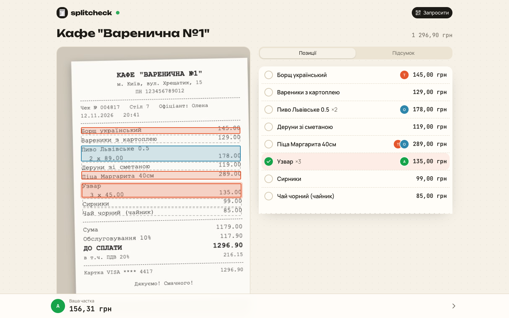
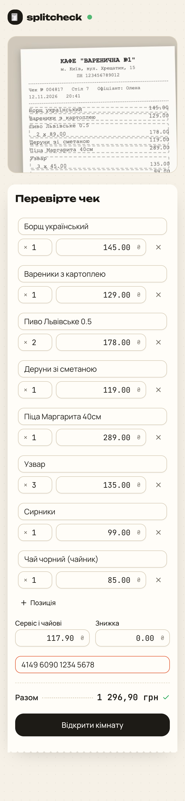
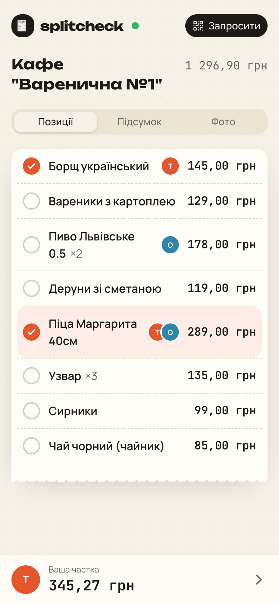
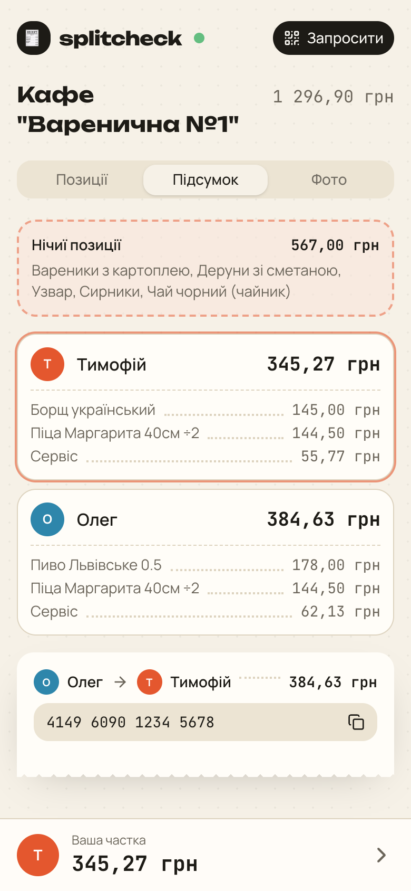
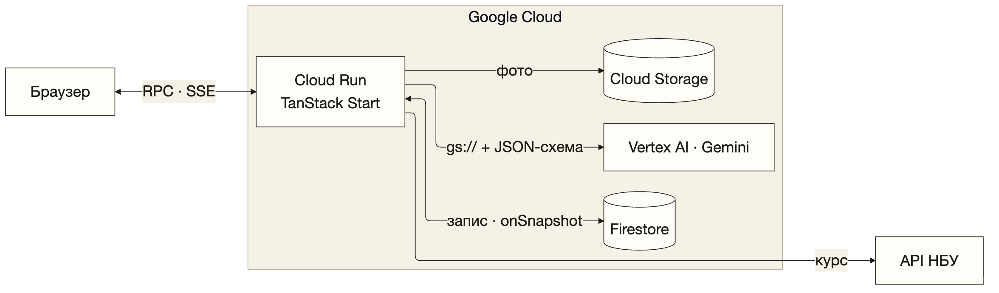
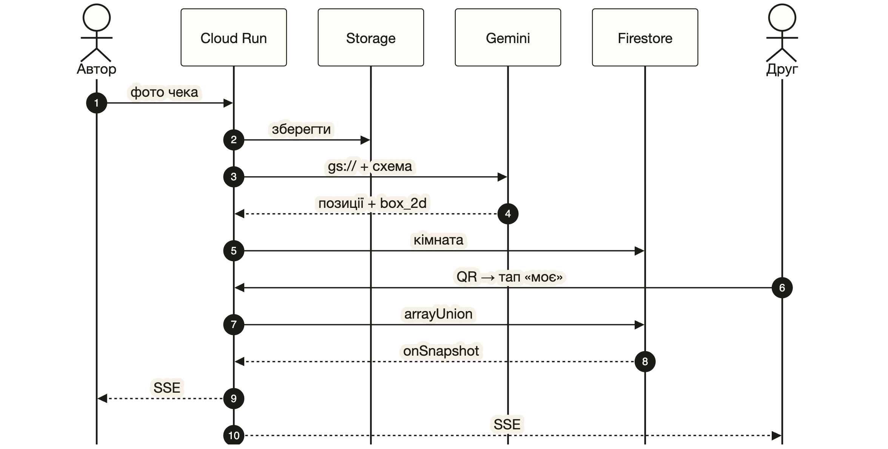

# 🧾 splitcheck

**Ділимо чек по позиціях з фото.** Сфотографуй чек — Gemini на Vertex AI розбере
його на позиції, друзі сканують QR, тапають те, що їли, і всі наживо бачать, хто
кому скільки винен. Сервіс і знижка діляться пропорційно, копійка в копійку.

PoC для лабораторної №2 з курсу «Хмарні обчислення».

**Live:** https://splitcheck-862950254949.europe-west1.run.app
(тестовий чек: [`docs/sample-receipt.png`](docs/sample-receipt.png))

**Презентація:** [`docs/presentation/slides.pdf`](docs/presentation/slides.pdf) ·
[pptx](docs/presentation/slides.pptx) · [демо-відео](docs/presentation/demo.mp4) · Marp + Mermaid, збірка: `docs/presentation/build.sh`



| Перевірка після Gemini | Кімната наживо | Підсумок |
|---|---|---|
|  |  |  |

## Навіщо

Банківські «спільні витрати» ділять тільки **загальну суму** — порівну або
вручну. Сервіси на кшталт Expirenza ділять по позиціях, але лише в ресторанах,
чия каса з ними інтегрована. splitcheck працює з **будь-яким паперовим чеком**:
ресторан, супермаркет, поїздка за кордон.

## Архітектура





| Сервіс / API | Роль | Як викликається |
|---|---|---|
| **Vertex AI — Gemini** (`gemini-3.5-flash`) | Розпізнає чек: позиції, кількість, суми, сервіс, знижку, валюту та **координати кожного рядка** на фото | `@google/genai`, `models.generateContent` зі **structured output** (`responseJsonSchema`); фото передається як `gs://` URI — Vertex читає його напряму з бакета |
| **Cloud Firestore** | Кімнати, учасники, хто що забрав; realtime-оновлення | `@google-cloud/firestore`: `batch`, `runTransaction`, `FieldValue.arrayUnion`, `onSnapshot`; TTL-політика на `expireAt` (7 днів) |
| **Cloud Storage** | Приватне сховище фото чеків | `@google-cloud/storage`; lifecycle-правило видаляє фото через 7 днів |
| **Cloud Run** | Хостинг SSR-застосунку + SSE-стрім | `gcloud run deploy --source .` (Cloud Build → Artifact Registry → Cloud Run) |
| **API НБУ** | Офіційний курс, якщо чек не в гривнях | `GET bank.gov.ua/NBUStatService/v1/statdir/exchange?valcode=EUR&json` |

**Автентифікація без ключів.** Усі клієнти використовують Application Default
Credentials: на Cloud Run — окремий сервіс-акаунт `splitcheck-run` з мінімальними
ролями (`datastore.user`, `aiplatform.user`, `storage.objectAdmin` лише на бакет).
У коді й репозиторії немає жодного секрету.

**Realtime без Firebase SDK у браузері.** Сервер тримає Firestore-listener
(`onSnapshot`) і пересилає кожну зміну в браузер через Server-Sent Events. Браузер
не потребує ні облікових даних Firebase, ні security rules.

**Захист від зловживань.** Публічний сервіс платить за кожен виклик Gemini, тож
завантаження чеків обмежене (8 за 10 хв з однієї IP, глобальна стеля на інстанс),
Cloud Run — максимум 3 інстанси, на проєкті бюджет-алерт $10. Server functions
захищені CSRF-перевіркою Origin (з урахуванням TLS-термінації Cloud Run).

**AI — це чернетка.** Після розпізнавання автор чека бачить фото з підсвіченими
рядками й таблицю, яку можна виправити. Застосунок звіряє суму позицій із
підсумком, надрукованим на чеку, і попереджає про розбіжність.

## Структура

```
src/
  server/
    gcp.server.ts        клієнти Firestore / Storage / Gemini (ADC)
    receipt.server.ts    промпт, JSON-схема, виклик Gemini
    rooms.server.ts      весь пайплайн: Storage → Gemini → НБУ → Firestore
    nbu.server.ts        курс НБУ
    rate-limit.server.ts ліміт завантажень чеків
  start.ts               CSRF-middleware для server functions
  lib/
    rooms.functions.ts   server functions (RPC з валідацією zod)
    split.ts             математика поділу (цілі копійки, метод найбільших залишків)
    room-query.ts        TanStack Query + SSE-підписка
  routes/
    index.tsx            завантаження фото
    r.$roomId.tsx        кімната
    api/rooms/$roomId/events.ts   SSE-стрім (Firestore onSnapshot)
    api/rooms/$roomId/image.ts    фото з приватного бакета
  components/            review-editor, item-list, receipt-image, summary, …
```

Стек: TanStack Start (React 19, SSR), TanStack Query, TanStack Form, shadcn/ui,
Tailwind 4, zod, Vitest.

## Запуск

### Інфраструктура (один раз)

```bash
P=your-project-id
gcloud projects create $P && gcloud config set project $P
gcloud billing projects link $P --billing-account=XXXXXX-XXXXXX-XXXXXX
gcloud services enable run.googleapis.com aiplatform.googleapis.com \
  firestore.googleapis.com storage.googleapis.com cloudbuild.googleapis.com \
  artifactregistry.googleapis.com
# новим проєктам іноді треба відкрити Vertex AI / Agent Studio в консолі
# і натиснути "Enable APIs", інакше Gemini повертає 404

gcloud firestore databases create --location=europe-west1
gcloud storage buckets create gs://$P-receipts --location=europe-west1 --uniform-bucket-level-access
echo '{"rule":[{"action":{"type":"Delete"},"condition":{"age":7}}]}' > lifecycle.json
gcloud storage buckets update gs://$P-receipts --lifecycle-file=lifecycle.json
gcloud firestore fields ttls update expireAt --collection-group=rooms --enable-ttl
gcloud firestore fields ttls update expireAt --collection-group=participants --enable-ttl

SA=splitcheck-run@$P.iam.gserviceaccount.com
gcloud iam service-accounts create splitcheck-run
gcloud projects add-iam-policy-binding $P --member=serviceAccount:$SA --role=roles/datastore.user
gcloud projects add-iam-policy-binding $P --member=serviceAccount:$SA --role=roles/aiplatform.user
gcloud storage buckets add-iam-policy-binding gs://$P-receipts --member=serviceAccount:$SA --role=roles/storage.objectAdmin
```

### Локально

```bash
gcloud auth application-default login
cp .env.example .env   # вписати GOOGLE_CLOUD_PROJECT і GCS_BUCKET
pnpm install
pnpm dev               # http://localhost:3000
pnpm test
```

### Деплой

```bash
gcloud run deploy splitcheck --source . --region europe-west1 \
  --service-account $SA --allow-unauthenticated \
  --set-env-vars GOOGLE_CLOUD_PROJECT=$P,GCS_BUCKET=$P-receipts,GEMINI_MODEL=gemini-3.5-flash,GEMINI_LOCATION=global \
  --timeout 3600 --memory 512Mi --min-instances 0 --max-instances 3
```

`--timeout 3600` потрібен, щоб SSE-з'єднання не обривалися щохвилини.
