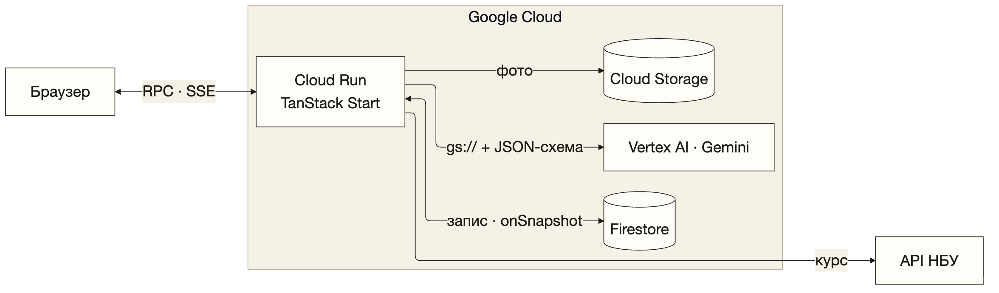
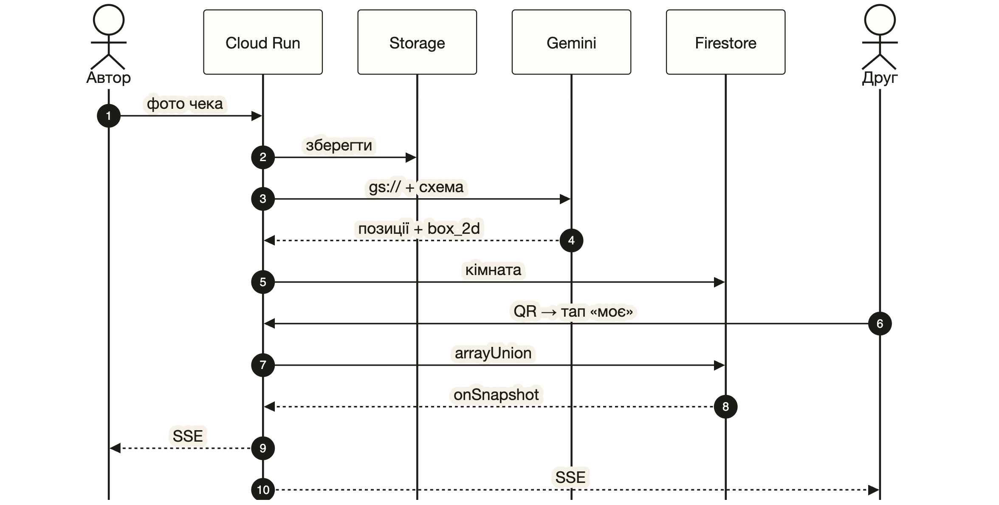
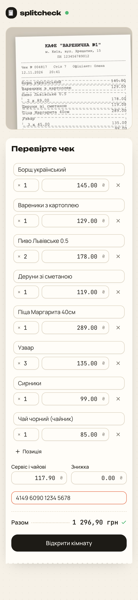
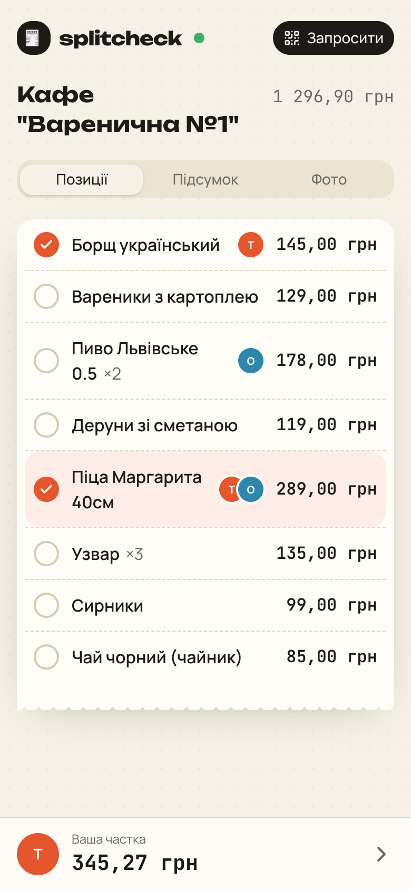
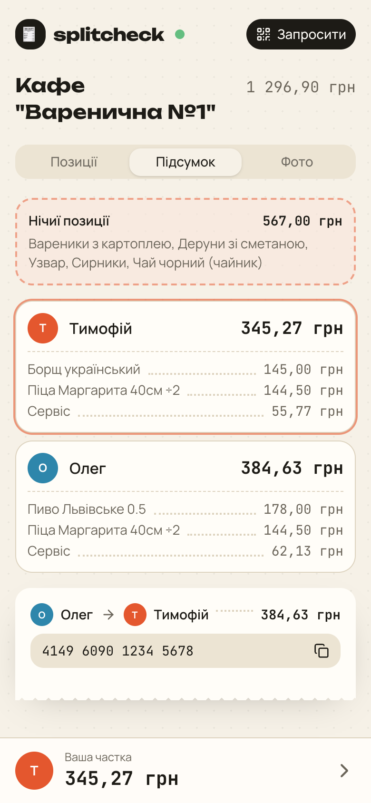

<!-- _class: title -->

# splitcheck

<p style="font-size:40px;font-weight:700;margin:20px 0 64px">Один чек. <em>Кожен платить</em> за своє.</p>

Тимофій Лейцишин · ТТП-42

---

# Суть

<div class="cols">
<div>

1. Фото чека → **Gemini** розбирає на позиції
2. Друзі сканують **QR** і відмічають своє
3. Кожен бачить свою частку **наживо**
4. Сервіс і знижка — **пропорційно**

</div>
<div>

**Де застосувати**

- Ресторани, бари, кафе
- Подорожі: чеки в іншій валюті
- Спільні покупки

</div>
</div>

---

# API

| Сервіс | Роль | Виклик |
|---|---|---|
| **Vertex AI · Gemini** | Розпізнає чек | `generateContent` + JSON-схема |
| **Firestore** | Кімнати й відмітки, realtime | `arrayUnion` · `onSnapshot` |
| **Cloud Storage** | Фото чеків | `file.save` · `gs://` |
| **Cloud Run** | Хостинг застосунку | `gcloud run deploy --source .` |
| **API НБУ** | Курс валют | `GET /NBUStatService/v1/statdir/exchange` |

---

# Архітектура



---

# Взаємодія



---

# Gemini: запит і відповідь

<div class="cols">

```ts
ai.models.generateContent({
  model: "gemini-3.5-flash",
  contents: [{ role: "user", parts: [
    { fileData: { fileUri: "gs://…/x.png" } },
    { text: PROMPT },
  ]}],
  config: {
    responseMimeType: "application/json",
    responseJsonSchema: receiptSchema,
    thinkingConfig: { thinkingLevel: "LOW" },
  },
})
```

```json
{
  "merchant": "Кафе «Варенична №1»",
  "currency": "UAH",
  "items": [{
    "name": "Пиво Львівське 0.5",
    "quantity": 2,
    "line_total": 178.00,
    "box_2d": [366, 123, 426, 950]
  }],
  "service_and_tip": 117.90,
  "total": 1296.90
}
```

</div>

<div style="display:flex;gap:80px;margin-top:36px">
<div><div class="stat">≈3.5 с</div>на чек</div>
<div><div class="stat">8 / 8</div>позицій розпізнано</div>
<div><div class="stat">≈2.5k</div>токенів</div>
</div>

---

# Результат

<div class="phones">



</div>

---

<!-- _class: video -->
<!-- _paginate: skip -->

<video src="demo.mp4" poster="img/demo-poster.jpg" controls muted playsinline preload="auto"></video>

---

<!-- _class: title -->

<div style="display:grid;grid-template-columns:260px 1fr;gap:56px;align-items:center">

<div>
<p style="font-family:'JetBrains Mono';font-size:32px;font-weight:700;margin:0">github.com/leitsyshyn/splitcheck</p>
<h1 style="font-size:64px;margin-top:40px">Дякую!</h1>
</div>
</div>
